# Gootloader Analysis

## Executive Summary

This malicious JavaScript file is distributed as a phishing email attachment which is disguised by its name, "hipaa_business_associate_agreement_template_word". This name helps to disguise its malicious behavior. When the user clicks on the file on a Windows system, it will execute quietly via the Windows Script Host engine. There are around 9,282 lines of non-malicious jQuery v3.6.0 JavaScript code. This allows it to go largely undetected with the malicious payload hidden around line 9,283 in the file. After performing dynamic analysis, it was discovered that the sample creates a Windows Script Host shell object and writes a registry key(`HKEY_CURRENT_USER\tHDtWG\`) that prevents reinfection of the same host. It then contacts three external domains(`www.lakelandartassociation.org`, `www.lha.co.ke`, `www.lesriceysimports.com`) to download and execute a secondary payload. In order to avoid automated sandbox analysis, the file has three CPU-burn delay loops that will then call a 182-hour sleep call.

## Technical Summary

File name: hipaa_business_associate_agreement_template_word 43165.js\
File type: JavaScript\
Malware Family: Gootkit\
Type: Rootkit/banker\
Downloaded from: MalwareBazaar (bazaar.abuse.ch)\
Sample date: 2022-05-11

**Key Findings**

- Lines 1-9,282 jQuery v3.6.0
- malicious payload at line 9,283 inside `nine0()`
- Three calls of function, `teeth18()`
- `string["constructor"](payload)()`

## Triage Results

**File Type/Hashing/etc.**

```
File: hipaa_business_associate_agreement_template_word 43165.js: JavaScript source, ASCII text
sha256sum: 9560fcb2abf1f071c2565870381104f1076cd71f0dd0200ef25ff15cb57f81a4
sha1sum: 3f1c0ed678bd12c0f8d619b3f6b6c48ae1e26bdd
md5sum: f635e16031a3b5c79070d3f03d6444f3

ssdeep: 6144:rJshNVaG+TCtlbhTmeKpntYmD2zK8L9JEjPx+WK+978Fya48L/dCfYQN8IPfVBY4:qcntYmD4x0Px+WK+978FygKrBPfgA+up
file size: 293105 bytes
delivery container: ZIP archive (single file)

```

**Virus Total Results**

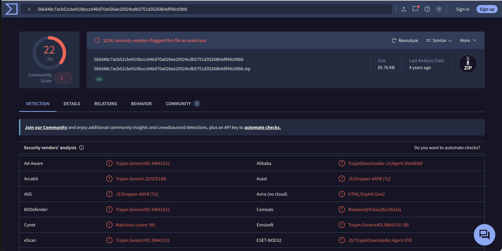
Figure 1

## Static analysis

Since this file is a JavaScript file, there is no PE/ELF binary structure. After looking at the source code, there was non-malicious code followed by a malicious payload around lines 9283 to 10983. From lines 1-9282 there is the jQuery v3.6.0 header, Sizzle CSS Selector Engine, followed by jQuery libraries. As for the malicious payload, there were many suspicious functions with abnormal names. The file closes at line 10983 with no malicious code and a simple return statement. Suspicious activity is typically appended or added in the beginning of malicious files, but this file attempted to hide it in the bottom before the very end.

**Header**
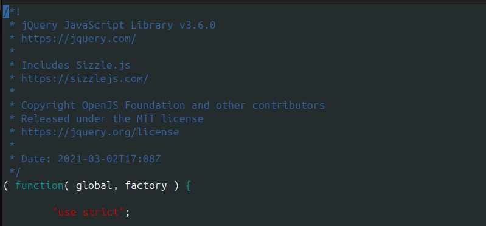
Figure 2a

**Footer**
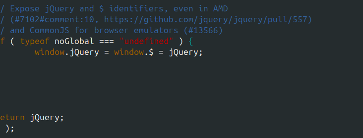
Figure 2b

**Notable imports:**

- `WScript.CreateObject("WScript.Shell")`
- `WScript.Shell.RegRead()`
- `WScript.Shell.RegWrite()`
- `WScript.sleep(658322795)`
- `ExpandEnvironmentStrings()`
- `Math.random()`
- `String.fromCharCode / parseInt`

**Suspicious Helper Functions**

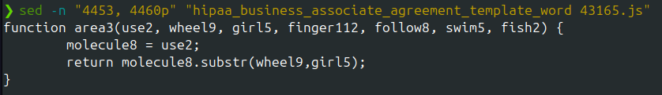
Figure 3a

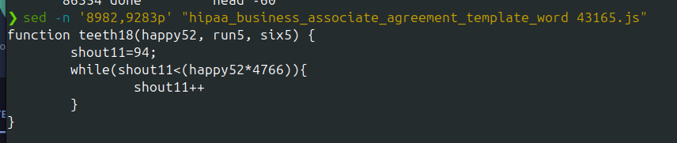
Figure 3b

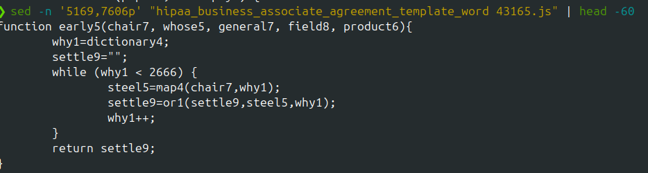
Figure 3c

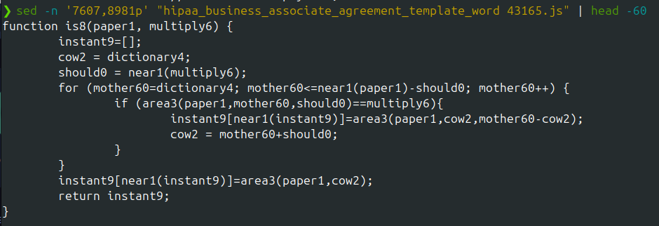
Figure 3d

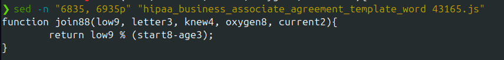
Figure 3e

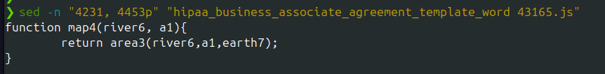
Figure 3f

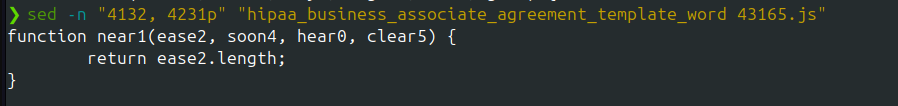
Figure 3g

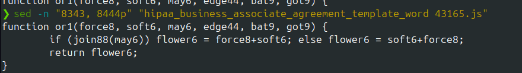
Figure 3h

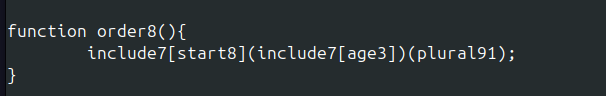
Figure 3i

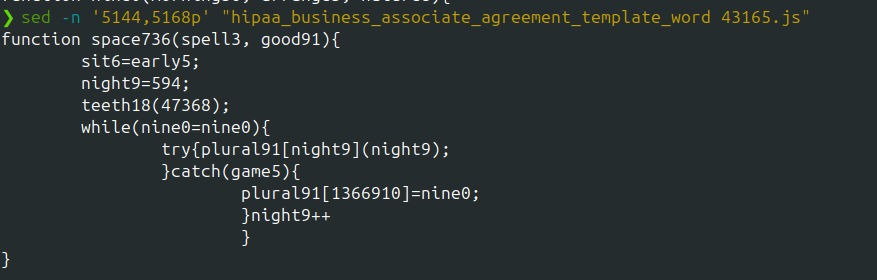
Figure 3j

**Stage 1 decoded payload:**

```
exact6 = WScript.CreateObject("WScript.Shell");
lake3 = "HKEY_CURRENT_USER\tHDtWG\";
try {
    exact6.RegRead(lake3);
} catch(e) {
    exact6.RegWrite(lake3, "", "REG_SZ");
    c = 10 - 7;   // c = 3
}
...
 WScript.sleep(658322795)
```

**Stage 2 decoded payload:**
C2 domains: `www.lakelandartassociation.org`, `www.lha.co.ke`, and `www.lesriceysimports.com`

Drop path: `WScript.Shell.ExpandEnvironmentStrings("%TEMP%" / "%APPDATA%")`

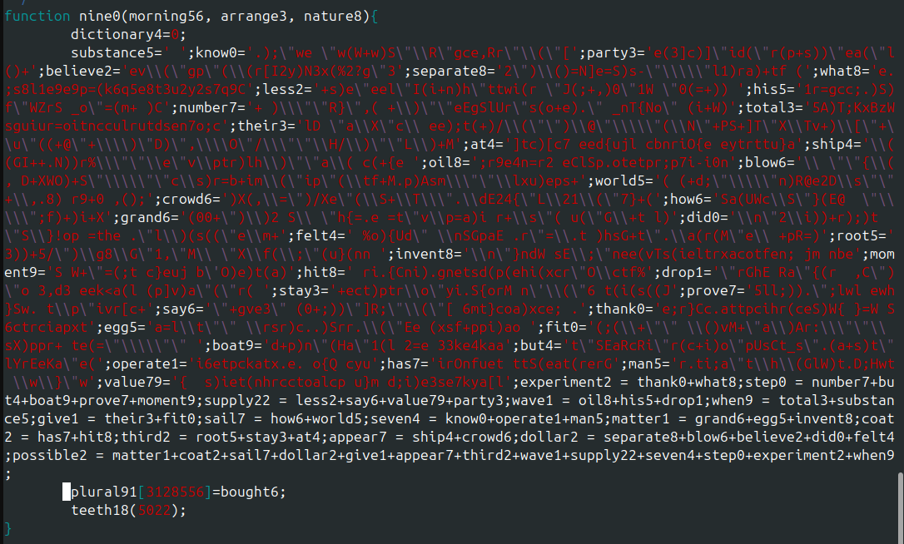
Figure 4

## Dynamic Analysis

After running the sample with Node.js with eval() neutralized, I found that there are only standard node.js startup syscalls only. There are no suspicious calls.

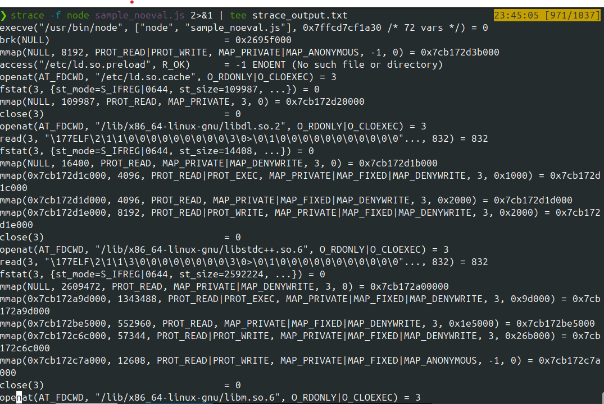
Figure 5a

After performing a tcpdump cature during a Node.js execution with eval() neutralized, there was no traffic generated. It was an empty capture. This is because the three C2 domains (`www.lakelandartassociation.org`, `www.lha.co.ke`, `www.lesriceysimports.com`) were recovered through static payload decoding and not through a live network observation.

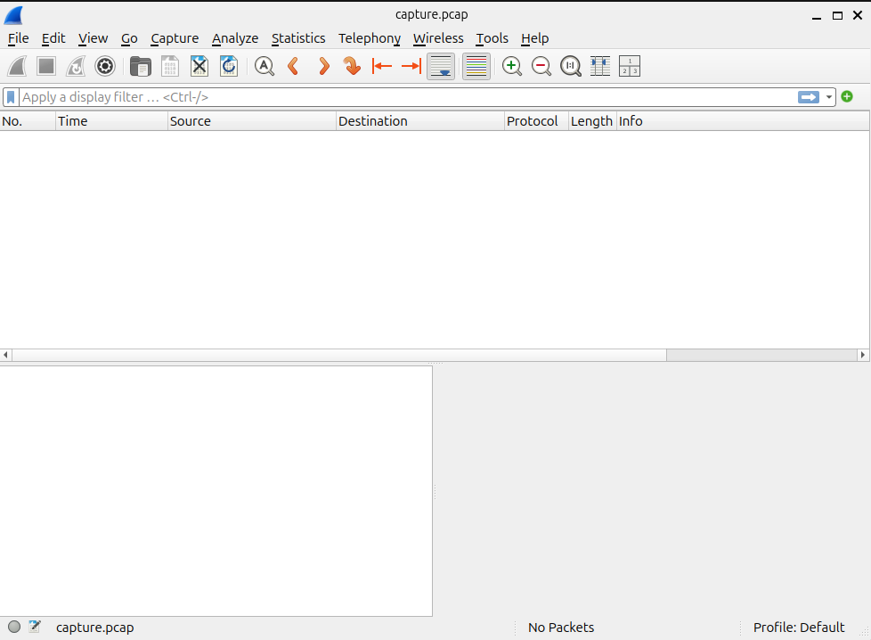
Figure 5b

As for the sandbox comparison, this was not performed. This is because of the 182-hour sleep function (`WScript.sleep()`) which would prevent any C2 activity showing up in a sandbox execution.

**Behavior**

1. `wscript.exe` executes file
2. `WScript.Shell` object is created
3. Registry writes `HKCU HDtWG\`
4. Forces a 182 hour sleep cycle
5. HTPP GET to 3 C2 domains
6. File dropped to `%TEMP%/%APPDATA%`

## Anti-Analysis Techniques

**Technique #1:**
The first technique I noticed was that the filename was disguised as a HIPAA legal document. This let me know that this might be more of a phishing/social engineering type scam. This type of technique might be found in an email that tries to lure the person into downloading the suspicious file onto their computer.

**Technique #2:**
The second technique I noticed was the amount of jQuery Library camoflauge in the source code. I checked the head and tail to see if there was anything malicious that was added or appended and could not find anything except normal JavaScript code. I also used the 'grep' command to find eval chains and/or suspicious strings. Since the functions were named strange names, it was difficult to locate the malicious code.

**Technique #3:**
After locating the malicious code, the payload was split across 30 different variables that are then reassembled into `possible2`.

**Technique #4:**
When analyzing the `is8()` function, I found that it splits on a key. This key was then identified in the `heart63` variable.

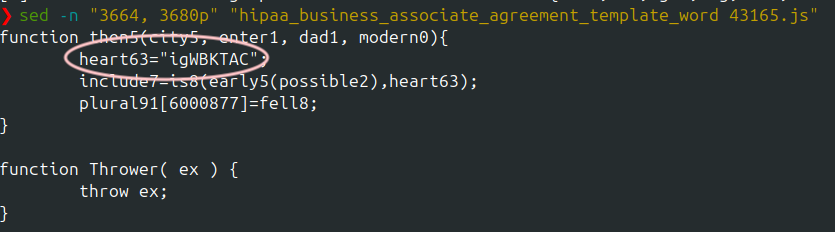\
Figure 6

**Technique #5:**
After identifying the payload launcher, the sample calls `is8(early5(possible2), heart63)` with the key `igWBKTAC` (refer to Figure 6) and stores this result in `include7` which is executed at line 5035 in the line, `include7[start8](include7[age3])(plural91)`.

**Technique #6:**
Stage 1 of the payload includes the 182-hour sleep function, which is called in line, `WScript.sleep(658322795)`.

**Technique #7:**
The CPU-burn anti-sandbox delay technique was shown when this line, `teeth18(): while(x < n*4766){x++}` was called 3 times.

## Classification

**Malware Family and Type**

The assignment provided the malware family, Gootkit, and the type, Rootkit/banker. My assessment of the file also matches this conclusion. Based on my research of Gootkit malware, I found that it often conceals code within altered versions of JavaScript libraries. This was discovered during static analysis where I found that there were over 9,000 lines of legitimate jQuery v3.6.0. The malware process typically begins with the victim downloading a zip file. According to Trend Micro (2022), Gootkit is known for using legal documents to trick users into downloading these files which matches the name of this sample. Gootkit also writes a randomly named JavaScript file to appdata\roaming using random naming conventions, and wscript.exe executes the JavaScript dropper which matches Stage 2 in the sample and the `ExpandEnvironmentStrings("%APPDATA%")` findings as well.

**Similarity table:**

| Gootkit Known Indicator         | Sample                                  |
| ------------------------------- | --------------------------------------- |
| JavaScript Libraries            | jQuery v3.6.0                           |
| Legal Document Name             | HIPAA Agreement                         |
| JS file in ZIP archive          | single .js in ZIP                       |
| WSH execution via `wscript.exe` | `WScript.CreateObject("WScript.Shell")` |
| Registry infection              | `HKCU\tHDtWG\`                          |
| %APPDATA% drop path             | `ExpandEnvironmentStrings()` in Stage 2 |
| JavaScript Libraries            | jQuery v3.6.0                           |
| Anti-sandbox delays             | `teeth18()` CPU-burn \* 3               |

**Research Links**

[Gootkit Malware Continues to Evolve with New Components and Obfuscations](https://thehackernews.com/2023/01/gootkit-malware-continues-to-evolve.html)

[Gootkit](https://any.run/malware-trends/gootkit/)

[Gootkit Italian Campaign Overview](https://www.f5.com/labs/articles/gootkit-italian-campaign-overview)

[The Goot cause: Detecting Gootloader and its follow-on activity](https://redcanary.com/blog/threat-intelligence/gootloader/)

**Capabilities:**

Some capabilities of this sample include: code execution via WSH, registry read/write, anti-sandbox sleep, CPU-burn sandbox evasion, etc.

**Likely Threat Actor:**

Based on the filename, it seems that this particular sample may be targeting someone/a group within the healthcare or legal field. Since HIPAA is a US regulation, the target seems to be located within the United States.

## Indicators of Compromise ~ Complete IOC Table

**File Data table (File Hashes and Paths)**
| Type | Value |
| ----------------- | -------------------------------------------------------------------------------------------------------- |
| SHA256sum-JS file | `9560fcb2abf1f071c2565870381104f1076cd71f0dd0200ef25ff15cb57f81a4` |
| SHA256sum-ZIP | `566d48c7acb52cbe910bccc646d70a026ee25924cdb5751d3526864df49c69bb` |
| MD5sum | `f635e16031a3b5c79070d3f03d6444f3` |
| SHA1sum | `3f1c0ed678bd12c0f8d619b3f6b6c48ae1e26bdd` |
| ssdeep | `6144:rJshNVaG+TCtlbhTmeKpntYmD2zK8L9JEjPx+WK+978Fya48L/dCfYQN8IPfVBY4:qcntYmD4x0Px+WK+978FygKrBPfgA+up` |
| Filename pattern | `hipaa_business_associate_agreement_template_word 43165.js` |
| File size | 293,105 bytes |

**Registry Keys**
| Type | Value |
|------|-------|
| Registry key | `HKEY_CURRENT_USER	HDtWG\` |
| Registry value | `""` (empty string) |

**Network Indicators**
| Type | Value |
|------|-------|
|C2 Domain| `www.lakelandartassociation.org`|
|C2 Domain| `www.lha.co.ke`|
|C2 Domain| `www.lesriceysimports.com`|

**Host-Based Indicators**
| Type | Value |
|------|-------|
| Process | `wscript.exe` or `cscript.exe` |
| WSH method | `WScript.CreateObject("WScript.Shell")` |
| Drop path | `%TEMP% or %APPDATA% (resolved via ExpandEnvironmentStrings)` |
| Dropped filename | `Math.random().toString()[2,98+n]` — randomized |

**Code Indicators**
| Type | Value |
|------|-------|
| Cipher key | `igWBKTAC` |
| Malicious function | `nine0()` |
| Anti-sandbox function | `teeth18()` |
| Execution pattern | `include7[3]["constructor"](payload)()` |

## YARA Rule

[rule.yar](rule.yar)

## Methodology

**Analysis Environment**

- REMnux Linux within an VirtualBox isolated virtual environment

**Tools**

- `js-beautify`, Wireshark, VirusTotal, MalwareBazaar, `python3`

**Workflow**

###### Extraction/Triage/Static Analysis

First, I downloaded the sample from MalwareBazaar and extracted it with the password, 'infected'. After it was extracted, I performed a triage to gain simple information about the file. Using `js-beautufy` and `grep`, I looked for keywords such as `http`, `powershell`, `wscript`, `registry`, etc. With these `grep` commands, I was able to recognize that most of the code is simply jQuery v3.6.0. There were some hits from `eval()/fromCharCode` but they were all internal to jQuery's own Sizzle selector engine and not malicious obfuscation. I also checked the head and tail of the file to see if there was anything malicious that was appended or added to the beginning. I was not able to find the malicious payload until I received some help on where to start looking. After I got the hint, I opened the file in a file editor and found suspicious activity around line 9,283. There was a function called `nine0()` (refer to Figure 4) that was not from the JavaScript library. It seemed suspicious due to the amount of suspicious names such as `teeth18()`(refer to Figure 3b), `boat9`, `sail7`, `dollar2`, etc. After extracting all the suspicious functions, I was able to see that all the functions are reimplemented. Once I had all the functions, I performed decoding on both stage 1 and stage 2 of the payload.

###### Dynamic Analysis/Automated Analysis

After running strace. I also performed a network capture and opened it in Wireshark. After running the sample while monitoring the network, there were no captures or any activity. This is because I replaced eval() with console.log() to prevent malicious code from running. I performed the network capture as required by the assignment, but as a safety measure, I did not execute this sample even in a virtual environment. In this particular case, I was able to recover the C2 domains through static decoding without the risk of live execution.

## Automated analysis

The Gootkit decode pipeline (`early5`, `is8`, `teeth18`) was reimplemented as a C target compiled with AFL++ instrumentation and
AddressSanitizer (`AFL_USE_ASAN=1 afl-cc`) per the course's instructions. AFL was then run for 54 minutes against 4 seed inputs derived from the actual sample's payload.

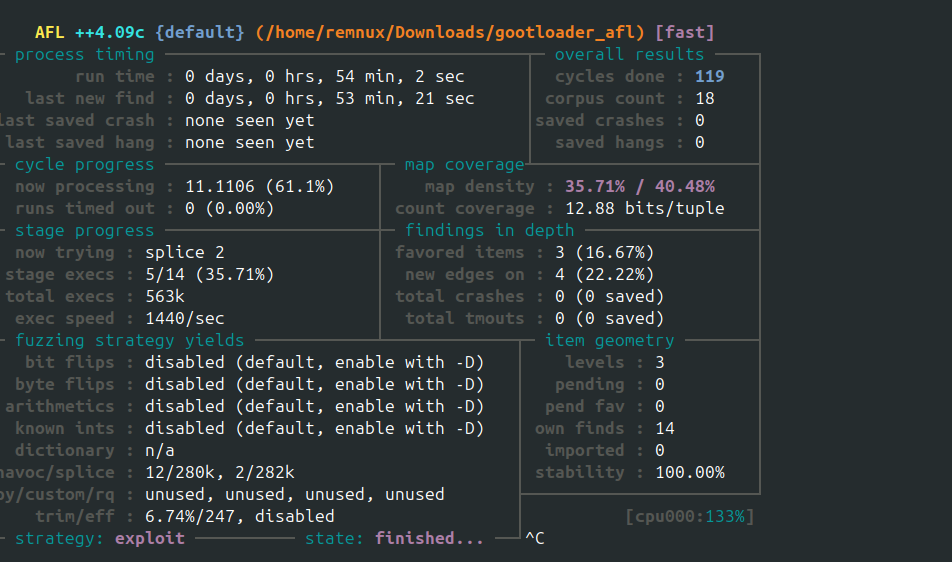

**Results:**

- Runtime: 54m 2 s
- Cycles: 119
- Total execs: 563,000

After running AFL for the second time, here were some of the findings:

1. AFL++ proves the cipher logic in the sample has at least 21 distinct states depending on input structure
2. There are zero crashes and zero hangs which confirms the C reimplementation of the decode pipeline.
3. Deterministic anti-sandbox design confirmed - busy-wait loop is hardcoded
4. Decode pipeline's branch space is finite and small

What AFL++ did not find that was found in manual analysis:
AFL++ did not recover the C2 domains, registry key, or WSH execution primitives.

**Queue Listing**

[afl_queue.txt](afl_queue.txt)
(queue listing for first sample which ran for 10m - not pictured)

## Limitations

There are many limitations to the documented full analysis report. One limitation is that the Windows dynamic behavior was not observed. All the registry writes, C2 HTTP requests, file drops, etc were not observed live. All the findings are based on static payload decoding. Another limitation would be that the three C2 domains were identified statically but not contacted. This would require live network access. Lastly, there was no sandbox testing. This is because the 182-hour sleep would prevent any meaningful sandbox behaviorial output.
